# computer-vision-from-scratch

Classic computer-vision algorithms implemented from scratch with NumPy, then checked against OpenCV / scikit-image
and against synthetic cases. Everything is demonstrated on the free sample images shipped with
`scikit-image` (`skimage.data`), and every figure in [`results/`](results) is regenerated by the scripts in
[`examples/`](examples).

| Module | What is inside |
|---|---|
| [`cvlib/template_matching.py`](cvlib/template_matching.py) | Normalized cross-correlation in three flavours (naive loops, vectorised, `im2col` matrix product), mean-subtracted NCC (= `TM_CCOEFF_NORMED`), greedy non-maximum suppression, Sobel and diagonal gradients, zero padding |
| [`cvlib/edges_hough.py`](cvlib/edges_hough.py) | Canny pipeline (Gaussian blur, Sobel, NMS with and without interpolation, double threshold, hysteresis), Hough transform for lines, circle Hough transform (full-circle votes, size-weighted votes, gradient-direction votes) |
| [`cvlib/segmentation.py`](cvlib/segmentation.py) | K-means and Mean-Shift colour segmentation (with the basin-of-attraction speed-up), Gabor and Laplacian-of-Gaussian filter bank, texton dictionary, windowed texton histograms (integral-image implementation) |
| [`cvlib/features.py`](cvlib/features.py) | Harris corners, naive and simplified-SIFT descriptors, k-NN and ratio-test matching, normalized DLT homography, RANSAC, image stitching, mirror-symmetry detection from mirrored SIFT descriptors + Hough voting |
| [`cvlib/viz.py`](cvlib/viz.py) | Plotting helpers |

## Quick start

```bash
pip install -r requirements.txt
python examples/01_template_matching.py
python examples/02_canny_hough.py
python examples/03_segmentation.py
python examples/04_features_stitching_symmetry.py
python -m pytest tests
```

Each script writes its figures and small tables to `results/`.

## Results

### Template matching

Three implementations of the same normalized cross-correlation return identical responses
(checked against `cv2.matchTemplate`); only the cost changes.

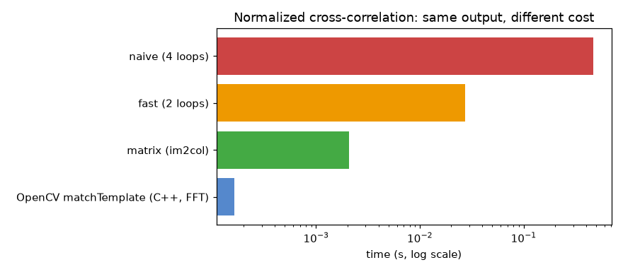

| implementation | time (s) | speed-up vs naive |
|---|---|---|
| naive (4 loops) | 1.25 | 1x |
| fast (2 loops) | 0.091 | 14x |
| matrix (im2col) | 0.011 | 115x |
| OpenCV `matchTemplate` | 0.0003 | 4,113x |

*120x90 image, 15x15 template, grayscale, one machine. Timings vary; the ordering does not.*

Subtracting the mean makes matching robust to a change of lighting. On a checkerboard re-lit with
`0.4 * I + 100 + ramp`, plain NCC finds none of the 18 squares above a 0.95 threshold, while the mean-subtracted
version still finds all 18:

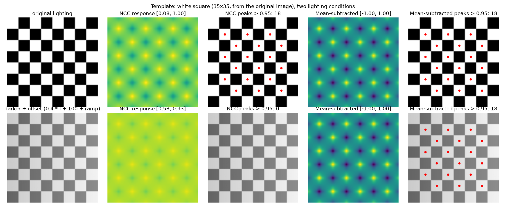

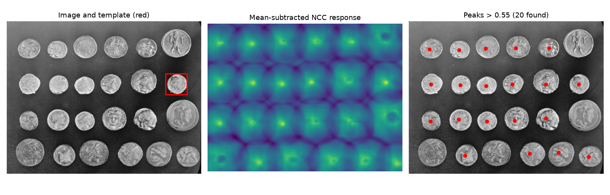

### Edges and Hough transforms

Our Canny agrees with `cv2.Canny` to within one pixel (precision 0.87, recall 0.88 on the `camera` image,
thresholds tuned by hand):

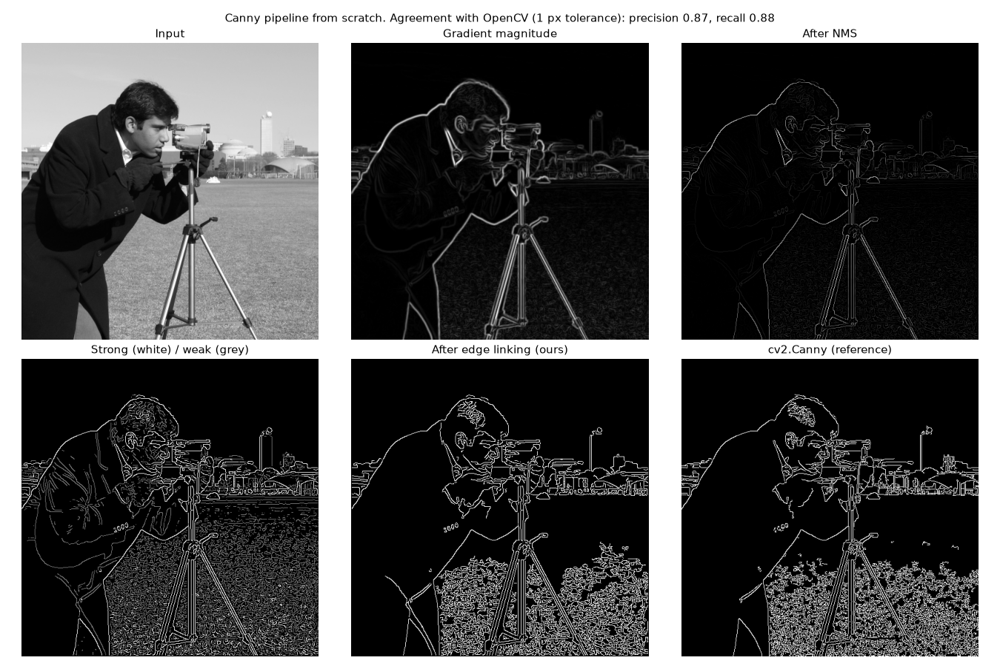

Lines on a rotated checkerboard (the dominant orientation, 15 degrees, is recovered):

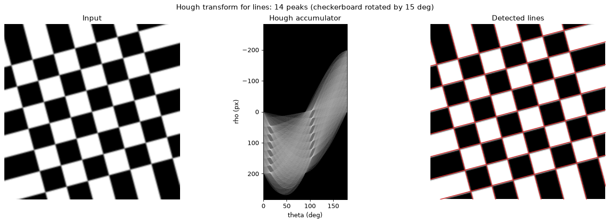

Circles on 24 coins, radii 16-60 px. Large circles collect many more votes than small ones, so unweighted
voting only finds the large coins. Weighting the votes by circle size recovers more of them, and voting along the
gradient direction costs a fraction of the time:

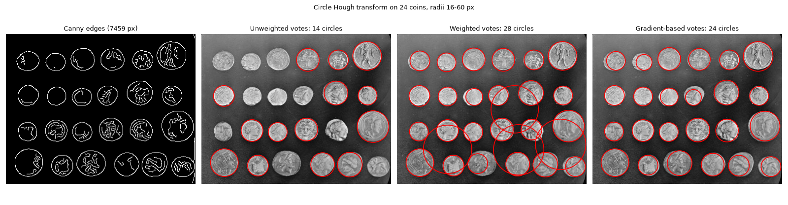

| method | vote time (s) | circles found |
|---|---|---|
| Unweighted votes | 2.25 | 14 |
| Weighted votes | 1.93 | 28 (some false positives) |
| Gradient-based votes | 0.13 | 24 |

*Peak thresholds are set by hand for each method, so the counts compare behaviours, not an absolute accuracy.*

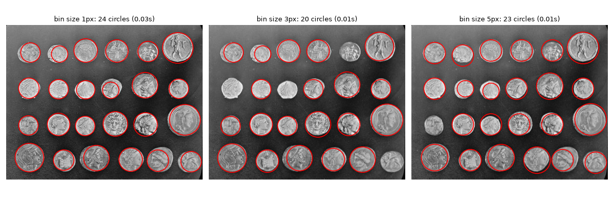

### Segmentation

Mean-Shift finds the number of segments on its own, controlled by the bandwidth, whereas K-means needs `k`:

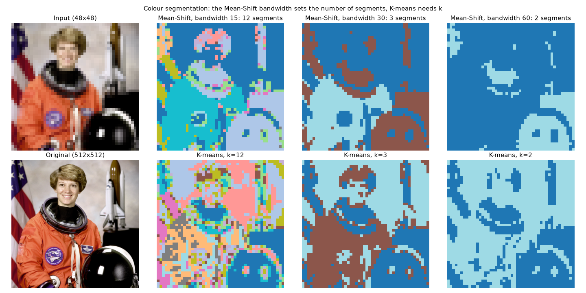

Texture segmentation on a mosaic of three textures (brick / grass / gravel) with a 12-filter bank
(8 Gabor + 4 LoG):

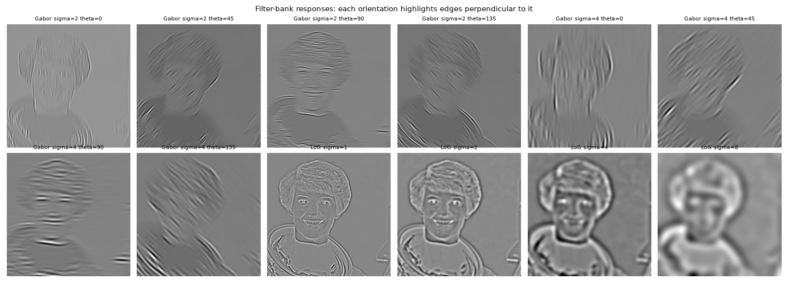

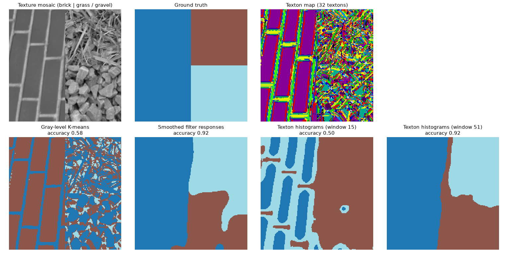

| method | pixel accuracy |
|---|---|
| Gray-level K-means | 0.58 |
| Smoothed filter responses | 0.92 |
| Texton histograms (window 15) | 0.50 |
| Texton histograms (window 51) | 0.92 |

*One synthetic mosaic and one random seed: treat the numbers as an illustration. Two things matter in practice:
filter responses must be rectified and standardised before smoothing, and the histogram window has to be large
enough to span the texture elements (here, the bricks).*

### Matching, stitching, symmetry

The simplified SIFT descriptor gives more matches than raw patches at the same ratio-test threshold, but it is not
rotation invariant:

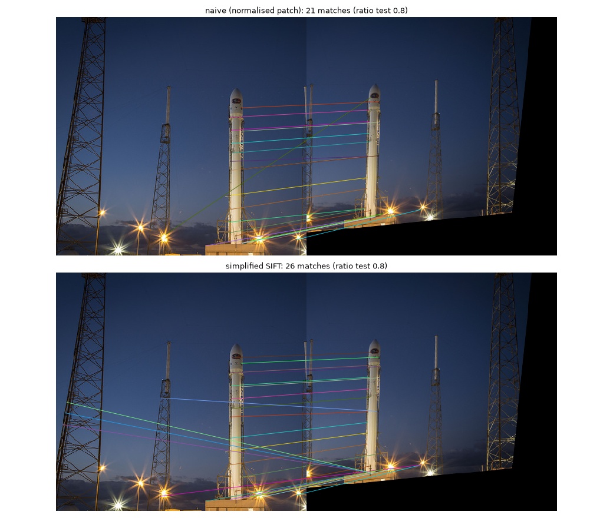

RANSAC turns 23 putative matches (some wrong) into 20 inliers and a clean panorama, where a least-squares fit on
all matches fails. When the second view is also rotated by 20 degrees, the simplified descriptor breaks down, so
that case uses OpenCV's SIFT:

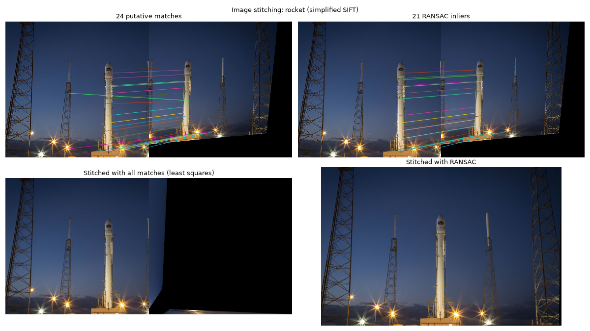

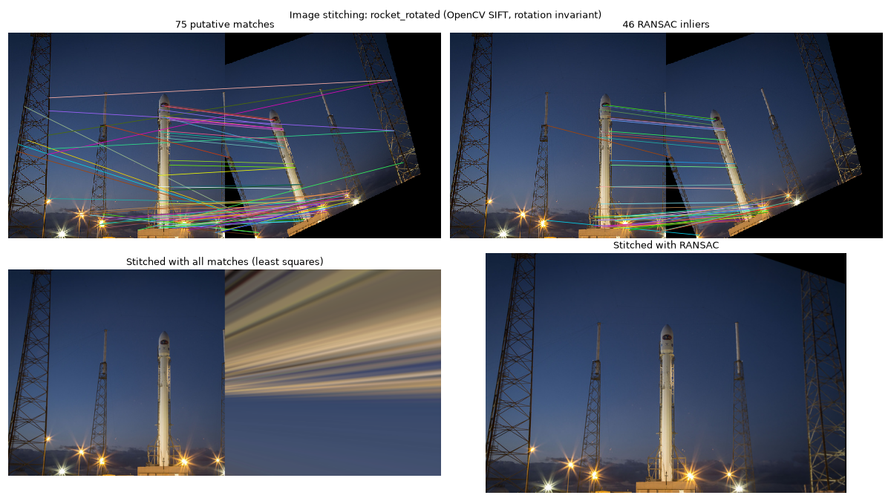

Mirror symmetry: SIFT descriptors are matched against mirrored descriptors (cell grid flipped, orientation
histograms reversed) and each matched pair votes for a mirror line in a `(rho, theta)` Hough space. On an image
made symmetric around column 159.5 the detected axis is `theta = 0, rho = 160`:

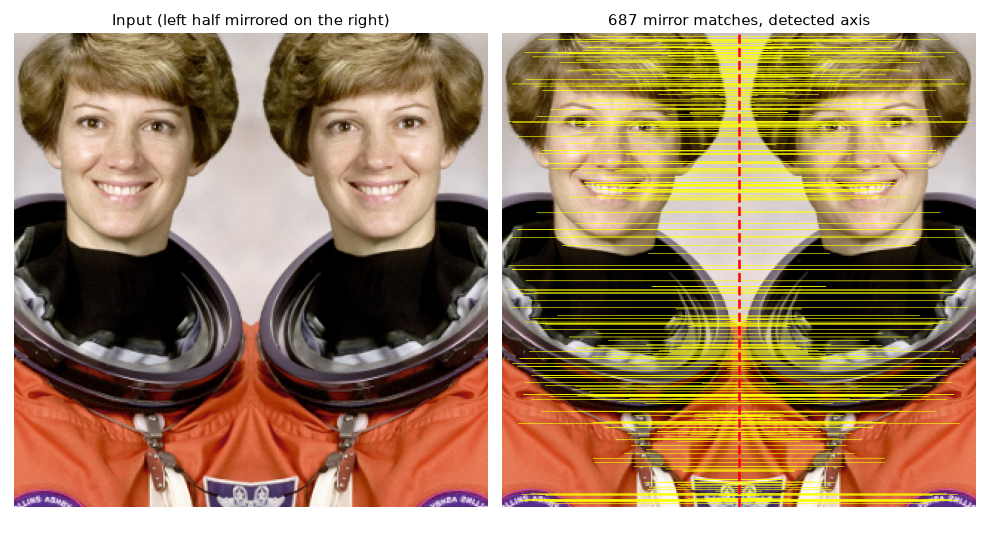

## Notes

- Conventions: image arrays are indexed `img[row, col]`. The Hough modules use `x` = row, `y` = column
  (`edges_hough`); keypoints in `features` are `(row, col)` and the mirror-line parameters use `x` = column,
  `y` = row. Each docstring states which one applies.
- The educational loops (`ncc_naive`, `ncc_fast`, `mean_shift_segmentation`) are kept on purpose as readable
  references for the vectorised versions.
- The tests in [`tests/`](tests) compare against OpenCV where an equivalent exists and otherwise use small
  synthetic cases with a known answer.
